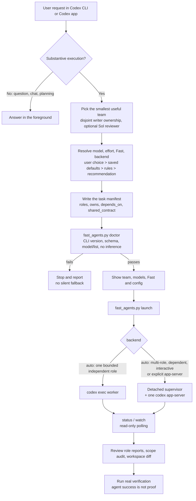
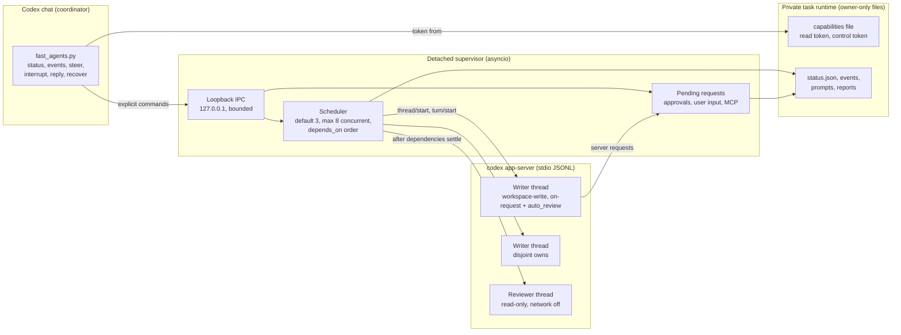
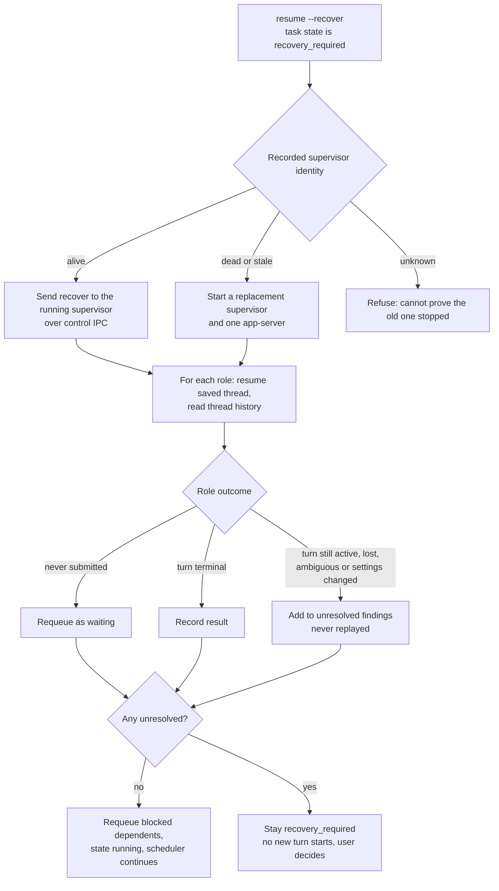

# How Fast Codex Subagents Works

This page shows the moving parts at a glance. The rules behind each step live in [the skill](../SKILL.md), [the manifest guide](manifest-guide.md), and [runtime and safety](runtime-and-safety.md). This skill runs on Codex only.

## End-to-end flow

The Codex chat stays the coordinator. It plans the team, checks the local Codex install, launches a detached task, and then only polls or sends explicit control commands.

## App-server runtime

One supervisor owns one `codex app-server` process per task. Each role is a separate logical thread with its own history. The parent chat talks to the supervisor only through the authenticated loopback endpoint.

Key boundaries:

- `status` and `events` use the read token. `steer`, `interrupt`, `reply` and `recover` need the control token; `steer`, `interrupt` and `reply` also need the current thread, turn or request IDs.
- The supervisor never blanket-approves. Approval requests wait in the pending list until an explicit scoped `reply`.
- Declared `owns` paths coordinate writers; they are not a per-file sandbox. Review the diff.
- Closing the chat or a `watch` terminal does not stop workers. Only an explicit `control interrupt` cancels a turn.

## Recovery

When a task is in `recovery_required`, `resume --recover` reconciles saved state instead of starting over. Recovery only continues when every role is proven; any doubt keeps the whole task blocked.

A recover that runs longer than the control call's wait keeps running inside the supervisor; the caller gets an `in_progress` reply and should poll `status`.

## Fast evidence

Each worker reports three separate facts: the requested tier, the effective thread tier reported by app-server, and upstream execution, which stays `unverified` without provider telemetry. On the app-server backend, a requested `priority` tier that is not confirmed effective fails before its turn starts. The `exec` backend can only pass the requested tier as CLI flags; its effective tier is read from the worker's events afterwards and stays `unverified` without correlated evidence.
